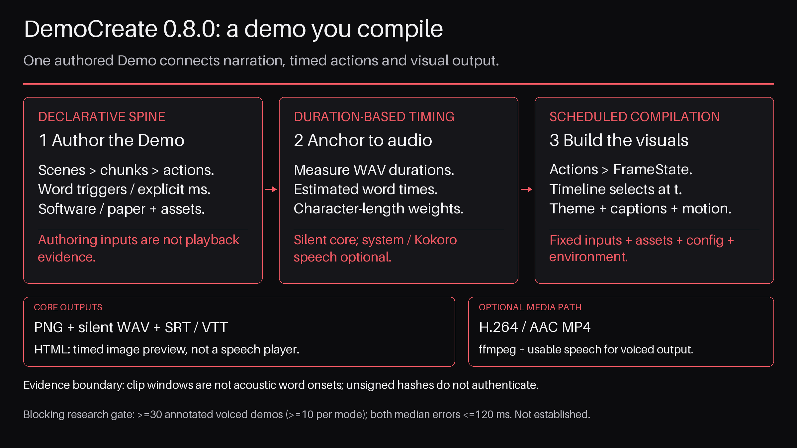
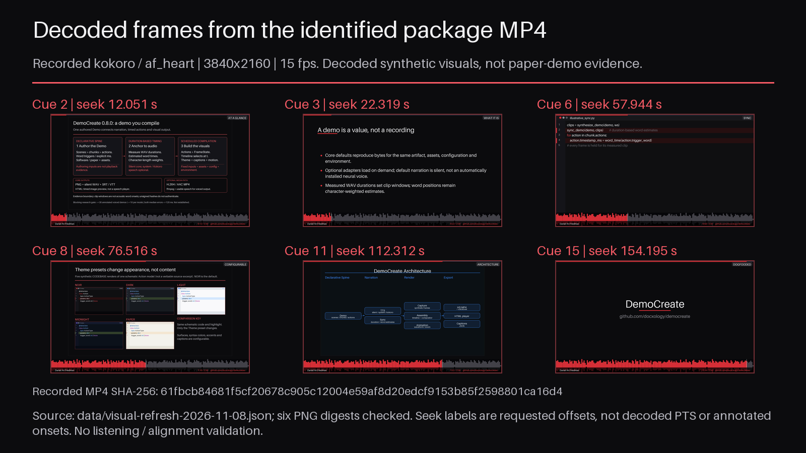

# DemoCreate

**Declarative audio-visual demos for software packages and research papers.**

Author a `Demo` (scenes → narration chunks → virtual editor, terminal, browser or
slide actions), then rebuild rather than re-record. The core produces **silent
WAVs, synthetic PNGs, captions, a transcript and a timed HTML image preview**.
The preview is not a speech player. Spoken MP4s require an implemented voice
backend and ffmpeg/ffprobe; PDF ingestion requires poppler. Installing an extra
is not evidence of model, adapter or host readiness.

- **Status:** alpha; candidate **0.8.0**, schema **1.1**. Python floor **3.11.5**,
  core development pin **3.15**, Pillow **≥13**. See [pyproject.toml](pyproject.toml).
- **CI:** [](https://github.com/docxology/democreate/actions/workflows/ci.yml)
  — native lint, types and the unchanged **≥90% pure-core coverage gate**.
- **Documentation:** [purpose-oriented guides and references](docs/README.md).
- **Concept DOI:** [10.5281/zenodo.20693216](https://doi.org/10.5281/zenodo.20693216).



## Install and build an offline preview

From a checkout, with [uv](https://github.com/astral-sh/uv) installed:

```bash
uv venv --python 3.15
source .venv/bin/activate
uv pip install -e .
democreate init demo.json
democreate inspect demo.json
democreate build demo.json --tts silent -o output
```

Open `output/web/player.html` in a browser. Keep its sibling `frames/` directory:
the HTML embeds navigation and captions, not image bytes or narration audio.
See the [quickstart](docs/quickstart.md) for the workspace and library workflow.

## Render a spoken video

A usable OS voice (`say` or `espeak`/`espeak-ng`) plus ffmpeg/ffprobe needs no
optional Python package:

```bash
democreate render demo.json -o output --tts system
democreate verify output/video/demo.mp4 --width 1920 --height 1080
```

The system-voice availability probe must actually synthesize/transcode audio.
`build --tts auto` deliberately selects **silence**, never an installed voice.
Kokoro is implemented and requires its `tts` packages, compatible runtime and
local model/voices. The recorded voice environment used Python **3.14** because
the locked ONNX distribution has no CPython 3.15 wheel; do not replace the core
pin or assume `.[all]` resolves on it. Provision that compatible environment
separately, then run its `democreate` executable:

```bash
uv pip install -e ".[tts]"
democreate fetch-voice
democreate render demo.json --tts kokoro --voice af_heart
```

Model acquisition is an explicit download; subsequent synthesis can be local.
Whisper, Chatterbox, Manim and the legacy MoviePy compositor remain **unwired**;
extra installation does not implement them. Python AST analysis is implemented;
the `codebase` extra does not wire multi-language parsing. See the authoritative
[backend/prerequisite matrix](docs/backends.md), [audio guide](docs/audio.md) and
[video guide](docs/video.md).

## Choose a workflow and its controls

| Goal | Start here |
|---|---|
| Tour a repository or summarize a folder of projects | [CLI: tour and portfolio](docs/cli.md#tour), [recipes](docs/recipes.md) |
| Turn PDF text, supplied figures and code into a paper demo | [Paper ingestion and its heuristic limits](docs/paper.md) |
| Narrate and subtitle in different languages | [Localization](docs/translation.md) |
| Author timed events and reusable scene content | [Schema 1.1](docs/schema.md), [architecture](docs/architecture.md) |
| Select themes, geometry, pacing and motion | [Configuration and precedence](docs/config.md) |
| Export posters, GIFs, chapters or inspect unsigned metadata | [Recipes](docs/recipes.md), [provenance](docs/provenance.md) |
| Diagnose missing tools or inspect test policy | [Troubleshooting](docs/troubleshooting.md), [testing](docs/testing_philosophy.md) |
| Develop the package | [Source map](src/democreate/README.md), [script inventory](scripts/README.md), [generated API](docs/api.md) |

Background paths are relative to the input Demo directory by default; CLI
`--asset-root` selects another allowed image root. Library defaults use the
current working directory. The pipeline stages assets, leaves authored inputs
unchanged and exposes resolved timing/assets as `PipelineResult.demo`. Follow
[resolved-bundle instructions](docs/cli.md#image-authority-and-resolved-bundles)
when rebuilding emitted JSON.

## Inspect visual examples and source-bound evidence



The canonical showcase recipe is **Kokoro `af_heart`, 2160p**. Its identified
2026-11-08 engineering observation records H.264/AAC and non-silent audio, fifteen
caption cues and six decoded stills. It does **not** establish intelligibility,
acoustic synchronization or results for later source edits. See
[media recipes and identities](docs/videos.md), [synthetic gallery](docs/gallery.md)
and the immutable [0.8.0 engineering receipt](docs/release-0.8.0.md), backed by
[data/release-0.8.0.json](data/release-0.8.0.json). Historical paper stills and
unshipped external paper inputs are explicitly separate.

Reproducible core byte comparisons require fixed **input + assets + config +
environment** (including Pillow/FreeType), not an artifact alone. Native voices,
models, codecs and timestamped portfolio filenames add their own variability.
Measured WAV clip windows share a nominal video timebase; word triggers remain
character-weighted estimates, not acoustic onsets, and encoded endpoints can
vary with frame quantization/codec padding.

## Research and publication boundaries

Candidate 0.8.0 is not a published release. The unchanged blocking criterion
requires **≥30 independently annotated voiced demos, ≥10 per declared mode**,
with **both** the pooled absolute event-error median and the median of demo-level
absolute-error medians **≤120 ms**. Silence, generated timestamps and content
verification cannot satisfy that criterion. The configured GitHub release write
class is disabled; engineering integration is not release publication.

Unsigned poster hashes check selected Demo-content consistency, not authorship,
image/video identity or authenticity. See [provenance](docs/provenance.md).

## Citation and related work

The concept DOI resolves to the latest archived version, currently **0.6.2**
(2026-06-04); no version-specific DOI or publication date is asserted for 0.8.0.
Cite the exact version/source you used; see [citation metadata](CITATION.cff).

Prior art includes [CodeVideo](https://docs.codevideo.io/overview/),
[asciinema](https://asciinema.org/),
[code-video-generator](https://code-video-generator.readthedocs.io/en/latest/),
[Code2Video](https://arxiv.org/abs/2510.01174) and
[Paper2Video](https://arxiv.org/abs/2510.05096). Construction-model comparisons are
not measured superiority claims; see the [manuscript](docs/manuscript/README.md).

## License

MIT — see [LICENSE](LICENSE).
