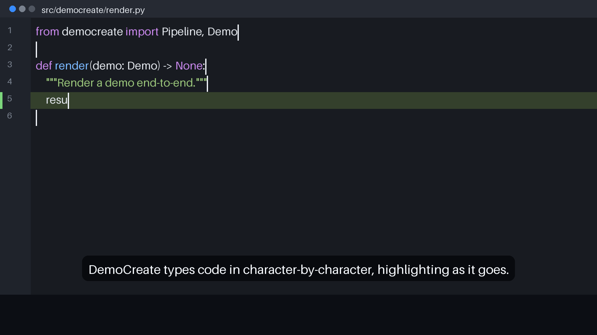
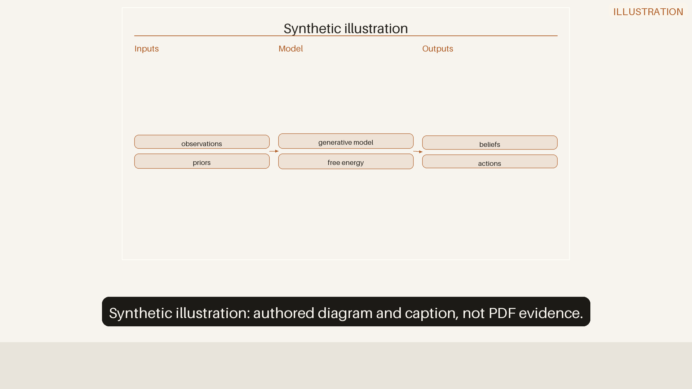
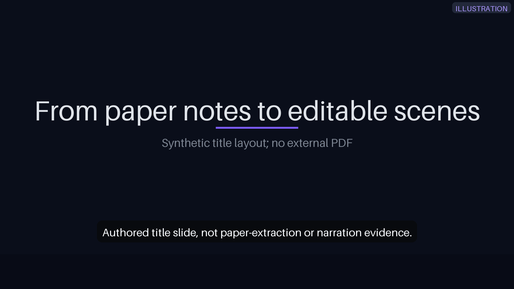
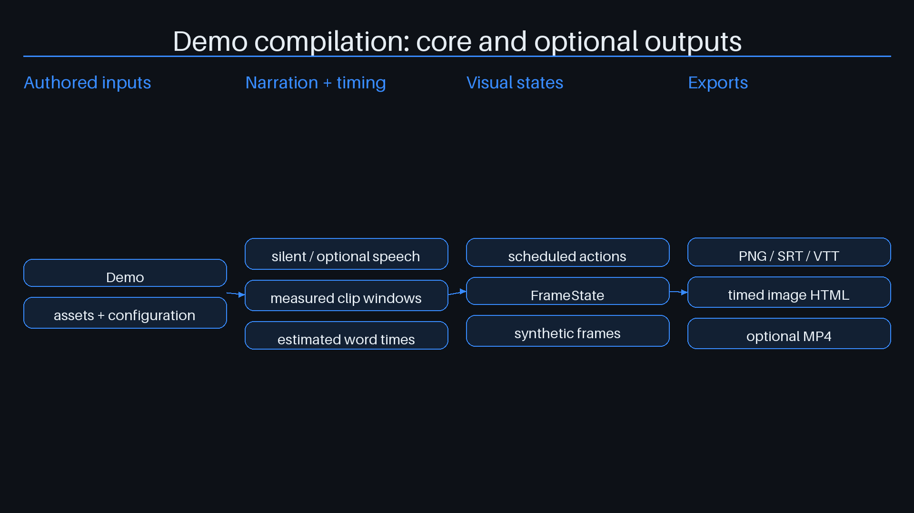
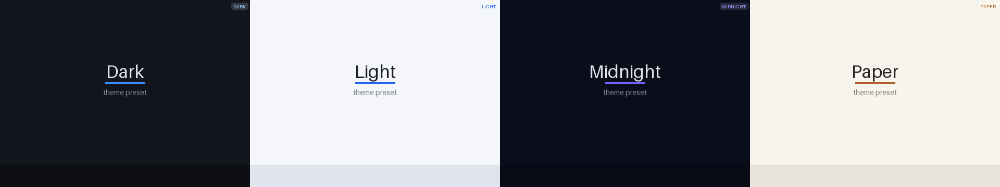

# Visual gallery: synthetic renderer and diagram examples

These images are **authored synthetic illustrations**, not extracted paper
results or decoded-video evidence. The gallery generator calls the package's
frame renderer and diagram APIs. Regenerate from the repository root with:

```bash
.venv/bin/python docs/_gallery/make_gallery.py
```

Reproduction requires fixed source, assets and Pillow/FreeType environment.
Committed PNGs are not proof that the current edited generator has been run.

## Character-count editor preview, not captured animation

An authored `codebase` FrameState reveals a fixed number of non-newline
characters through `cursor_typed`, with syntax color and an active-line highlight.
The displayed `illustrative_build.py` is an example of the public build API, not
a current repository source file; the gallery generator does not execute it.
This single synthetic state is not recorded or scheduled playback. See
[scheduled typing and preview semantics](video.md#typing-animation).



## Research-paper figure scene (paper theme)

A synthetic architecture diagram is used as a figure background on the `paper`
theme, contained inside the content area. Its diagram and caption are authored
illustration text, not extracted PDF evidence.



## Synthetic title layout without external-paper claims

A word-wrapped title, subtitle and section label demonstrate the `midnight`
theme. Neither the text nor the image establishes a paper's identity, page count,
extraction or narration quality.



## Authored compilation flow, not inferred dependencies

The [`animation/diagram.py`](api.md#democreateanimationdiagram) renderer draws
explicitly supplied columns and connectors. Here they illustrate
Demo → narration/timing → visual states → exports, separating core outputs from
optional speech/MP4. This is not a measured runtime or repository dependency graph.
Paper demos can use the same renderer for module-group overviews; generic
left-to-right connectors do not establish actual import dependencies.



## Theme strip — four of the five presets

The same slide rendered across four preset themes — `dark`, `light`, `midnight`,
`paper` — selectable with `--theme` (or pinned in a `--config` YAML). The fifth
preset, **noir** (the package-wide *default*: near-black surfaces, white text, a
single red accent), is not in this strip; see it in [videos.md](videos.md) and
[config.md](config.md#theme-presets), which lists all five.



## See also

- [recipes.md](recipes.md) — media workflows; [videos.md](videos.md) separates identified observations.
- [video.md](video.md) — scheduled typing, cursor, waveform and base-layout limits.
- [config.md](config.md) — themes and aspect ratios.
- [paper.md](paper.md) — how a paper becomes narrated figure/section scenes.
