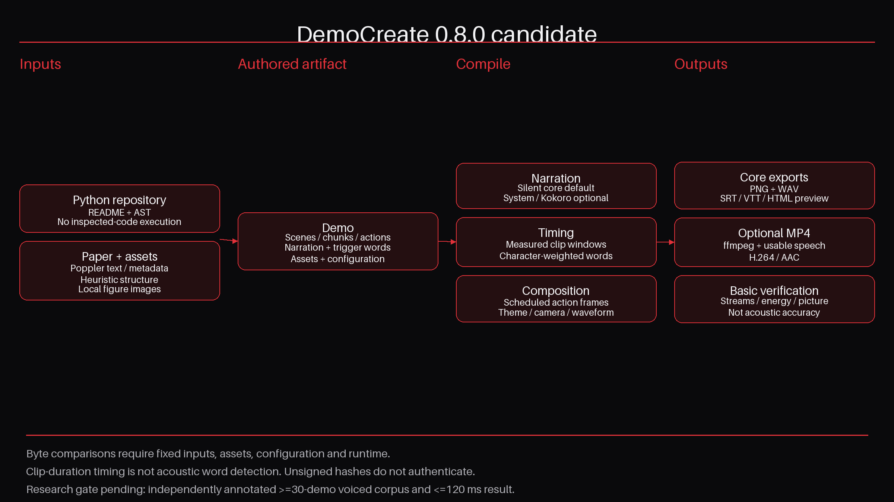

# Abstract {#sec:abstract}

{#fig:graphical_abstract}

DemoCreate compiles a declarative `Demo`—scenes, narration chunks and typed actions—into inspectable frames, captions, transcripts and an HTML player. Optional system or implemented local Kokoro speech synthesis and ffmpeg enable voiced MP4 output. Its action-stream organization is related to CodeVideo [@codevideo2024]; narration is organized into chunks and word triggers.

Default synchronization measures generated clip durations and interpolates known words by character length; it does not measure acoustic word onsets. Whisper, Chatterbox and Manim remain unimplemented optional slots. Render configuration controls themes, layout, motion, pacing and metadata. PDF ingestion uses poppler, not a Python PDF extra. Unsigned poster digests provide consistency checks, not authorship authentication or image/video identity.

Engineering acceptance uses a real-filesystem suite and a ≥90% core coverage gate, with fresh receipts required rather than a pinned suite count. Historical timing and media records are distinguished from source-bound candidate observations. A fresh Kokoro `af_heart` 2160p render passes structural media checks, not intelligibility or acoustic-onset evaluation. The ≥30-demo acoustic study and ≤120 ms median-error hypothesis remain planned and blocking. This manuscript describes candidate **0.8.0**, Python ≥3.11.5 and Pillow ≥13, with schema **1.1**; publication remains pending.
