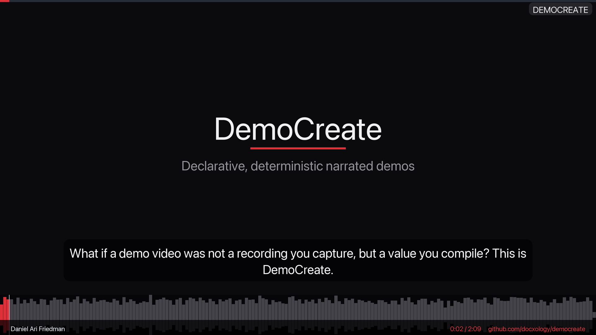
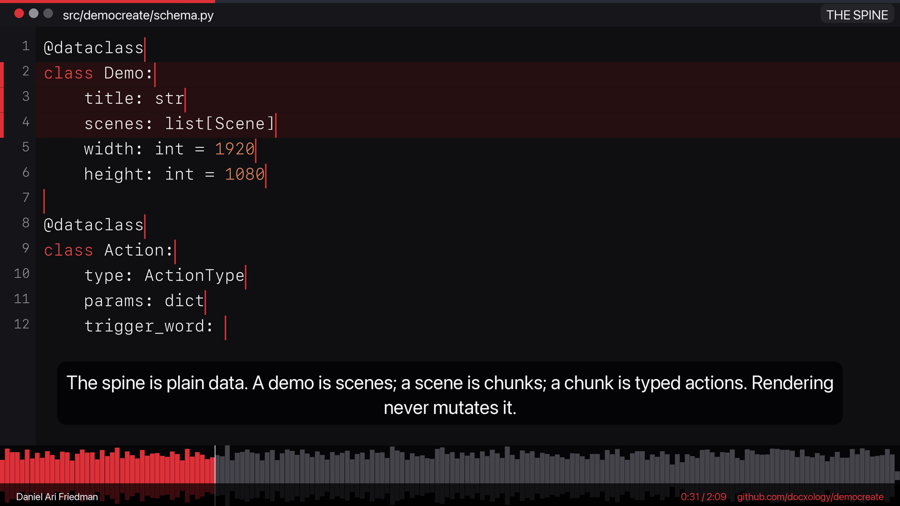
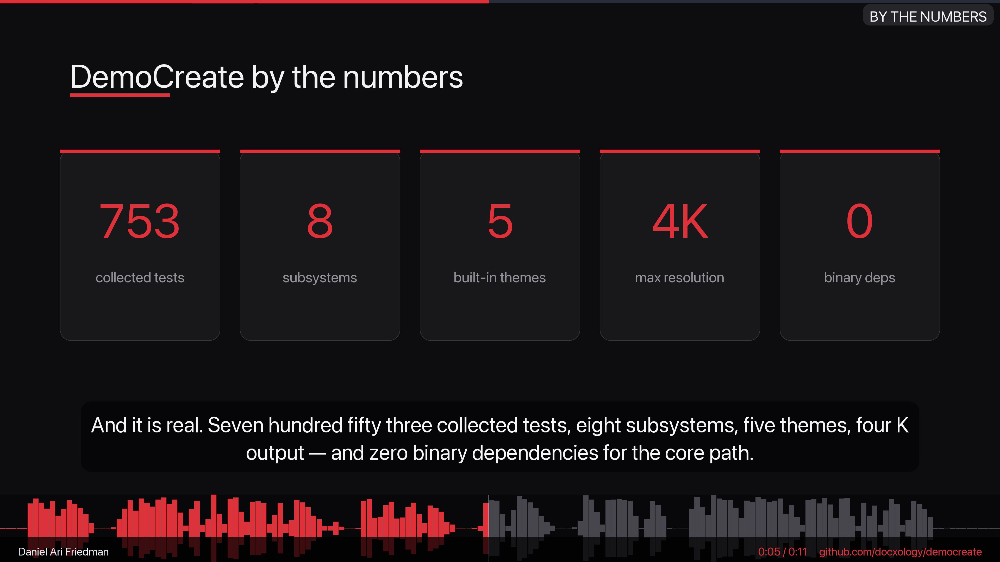
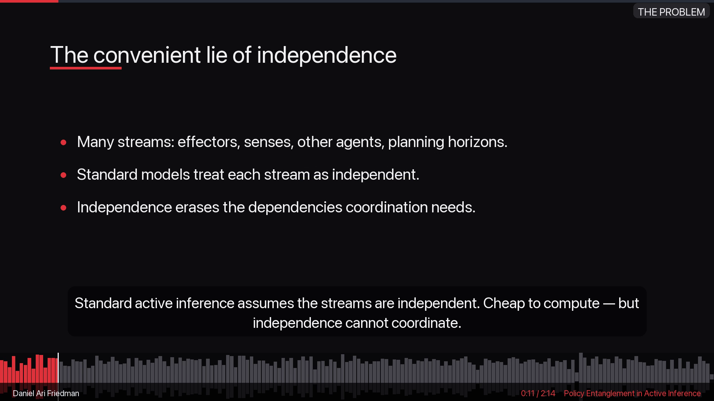
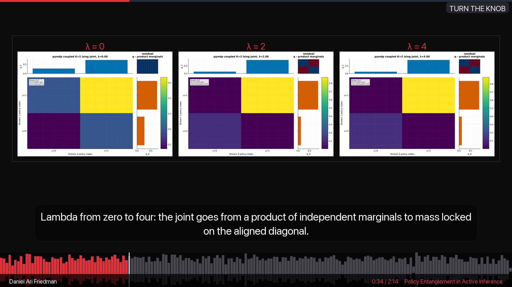
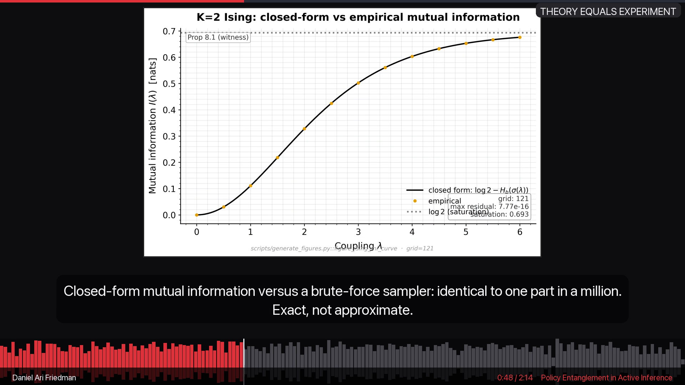

# Demo videos: recipes and identified evidence

Candidate **0.8.0** is pending publication. Generated videos live in ignored
`output/`; neither an output path nor a PNG still establishes current media
identity. Verification checks streams, duration, audio energy and sampled picture
variance—not intelligibility, scene correctness, acoustic synchronization or
cryptographic authenticity.

## Canonical package showcase

The canonical recipe remains **Kokoro `af_heart`, 2160p**. Required prerequisites:
installed `tts` extra in a compatible runtime, locally acquired model/voices and
ffmpeg/ffprobe. The **2026-11-08 refreshed source-bound run** reused the existing
Python 3.14.10 voice environment with asserted current-source imports, without
changing the core 3.15 pin. Updated cover/theme inputs and `illustrative_*.py`
code labels produced this distinct 3840×2160 H.264/AAC MP4:
`61fbcb84681f5cf20678c905c12004e59af8d20edcf9153b85f2598801ca16d4`.
Video/audio durations are 159.867/159.905 s. All fifteen SRT/VTT windows agree;
six decoded samples and audio amplitude were inspected. The
[structured receipt](../data/visual-refresh-2026-11-08.json) binds package, authored
Demo, background PNGs, model, caption, frame and video identities. An earlier
same-input reproduction is retained separately; it is not a claim of equality
after changed inputs, general neural determinism, listening or onset accuracy.
The [original record](release-0.8.0.md) remains immutable history. The MP4 is
unpublished; silent output is not an interchangeable replacement.

```bash
.venv/bin/python docs/manuscript/figures/make_figures.py
.venv/bin/python docs/manuscript/figures/graphical_abstract.py
.venv/bin/python examples/make_showcase.py
democreate render examples/democreate_showcase.json -o output \
  --tts kokoro --voice af_heart --resolution 2160p \
  --author "Daniel Ari Friedman" --watermark "github.com/docxology/democreate"
democreate verify output/video/demo.mp4 --width 3840 --height 2160
```
The recorded run used a repository-local **Python 3.14.10** voice environment;
the locked ONNX distribution has no CPython 3.15 wheel. The core pin remains
3.15. Run the media command with that compatible voice environment's executable,
not an assumed core `.venv` install. Model and voices paths were explicit.
matched before/after, but supplier digests were unavailable; hashes are not
publisher authentication. The 325 MB model exceeded the runner's 256 MiB
per-seed cap and was a manifest-bound runtime asset, not a kernel-protected seed.
The recipe does not burn captions unless `--captions` is supplied; SRT/VTT and
the timed HTML image preview remain companion outputs. The historical receipt
separately records decoded-pixel subtitle checks, not a new check of this tree.

The 15 authored scenes demonstrate slides, typing codebase views and illustrative
terminal output; there is no website scene. Current stat cards describe gates,
not a pinned suite count. Render duration depends on the chosen voice and config.
Earlier documentation recorded 155.6 seconds; that is historical, not a current
measurement of regenerated source.

Companion outputs include `web/player.html`, `chapters/youtube_chapters.txt`,
`captions/captions.srt`, `provenance/poster_signed.png` and `provenance.json`
under the workspace. The poster payload is unsigned; its historical filename is
not an authentication claim. See [provenance.md](provenance.md).

## Historical stills

All stills below predate the 2026-11-07 repair. Original extraction dates and
source-video digests are unrecorded; embedded suite counts and old narration are
not current evidence. Regeneration must establish new media identity before a
caption calls them current or associates them with a particular render.








## Optional curated paper showcase

`make_paper_showcase.py` is a hand-authored tour of *Policy Entanglement in Active
Inference*. Its scientific narration is supplied example content, not an
independent validation of the paper. The external paper source is **not shipped**.
Acquire its PDF, source and named figure outputs first, then explicitly provide
the paper root; no sibling lifecycle search or substitute paper is used.

```bash
.venv/bin/python examples/make_paper_showcase.py --paper-root /path/to/paper
democreate render examples/democreate_paper_showcase.json -o output/paper_showcase \
  --tts system --voice Daniel --author "Daniel Ari Friedman"
```

The builder copies external inputs into `examples/assets/paper/`, alongside the
Demo JSON. A missing required figure is an error, not a degraded substitute.
Historical documentation recorded approximately 168 seconds for this curated
artifact. It is distinct from the **template-generated** paper demo historically
recorded as 12 scenes and 188.0 seconds under `output/paper_demo/`:

```bash
democreate paper /path/to/paper.pdf --repo /path/to/source \
  --figures /path/to/figures -o output/paper_demo --theme noir
```

The paper workflow requires poppler; voiced rendering requires a usable TTS and
ffmpeg. No `pdf` pip extra exists. Neither historical duration is a current gate.
